# TÀI LIỆU ĐẶC TẢ NGHIỆP VỤ & HƯỚNG DẪN VẬN HÀNH HỆ THỐNG
# ENGSPEAK — AI-FIRST ENGLISH SPEAKING COACH (PHASE 1–8)

> **Mã tài liệu:** BA-DOC-ENGSPEAK-V1.0  
> **Người biên soạn:** Senior AI Business Analyst & System Engineer  
> **Trạng thái:** Approved / Production-Ready  
> **Đối tượng áp dụng:** Học viên (End Users), Chuyên viên Đào tạo (Instructors), Kỹ sư Vận hành (Engineers)  

---

## MỤC LỤC
1. [TỔNG QUAN SẢN PHẨM & MỤC TIÊU NGHIỆP VỤ](#1-tổng-quan-sản-phẩm--mục-tiêu-nghiệp-vụ)
2. [TỪ ĐIỂN THUẬT NGỮ & CHỈ SỐ ĐO LƯỜNG (GLOSSARY & METRICS)](#2-từ-điển-thuật-ngữ--chỉ-số-đo-lường-glossary--metrics)
3. [HẠ TẦNG KỸ THUẬT & HƯỚNG DẪN KHỞI CHẠY](#3-hạ-tầng-kỹ-thuật--hướng-dẫn-khởi-chạy)
4. [QUY TRÌNH NGHIỆP VỤ HỌC TẬP CHUẨN (STANDARD LEARNING JOURNEY)](#4-quy-trình-nghiệp-vụ-học-tập-chuẩn-standard-learning-journey)
5. [ĐẶC TẢ CHI TIẾT 12 MÀN HÌNH CHỨC NĂNG (SCREEN SPECIFICATIONS)](#5-đặc-tả-chi-tiết-12-màn-hình-chức-năng-screen-specifications)
   - [5.1. Dashboard Tổng quan (`/`)](#51-dashboard-tổng-quan-)
   - [5.2. Khảo sát năng lực ban đầu (`/baseline`)](#52-khảo-sát-năng-lực-ban-đầu-baseline)
   - [5.3. Sentence Builder — Ráp câu 3 tầng (`/sentence-builder`)](#53-sentence-builder--ráp-câu-3-tầng-sentence-builder)
   - [5.4. VN → EN Speaking — Phản xạ trực tiếp (`/vn-to-en`)](#54-vn--en-speaking--phản-xạ-trực-tiếp-vn-to-en)
   - [5.5. Spoken Repair Lab — Sửa lỗi khẩu ngữ tức thì (`/retry-lab`)](#55-spoken-repair-lab--sửa-lỗi-khẩu-ngữ-tức-thì-retry-lab)
   - [5.6. Survival Speaking — Phản xạ sinh tồn & Né từ cấm (`/survival`)](#56-survival-speaking--phản-xạ-sinh-tồn--né-từ-cấm-survival)
   - [5.7. Corodomo Shadowing Studio (`/shadowing`)](#57-corodomo-shadowing-studio-shadowing)
   - [5.8. Phòng luyện nói Live (`/session`)](#58-phòng-luyện-nói-live-session)
   - [5.9. Phòng Drill phản xạ đơn câu (`/practice`)](#59-phòng-drill-phản-xạ-đơn-câu-practice)
   - [5.10. Thế giới giao tiếp & Hội thoại AI nhập vai (`/conversation`)](#510-thế-giới-giao-tiếp--hội-thoại-ai-nhập-vai-conversation)
   - [5.11. Thử thách nâng cao — Áp lực & Lập luận Toulmin (`/advanced`)](#511-thử-thách-nâng-cao--áp-lực--lập-luận-toulmin-advanced)
   - [5.12. Cài đặt hệ thống, Micro & Quản trị API Keys (`/settings`)](#512-cài-đặt-hệ-thống-micro--quản-trị-api-keys-settings)
6. [MA TRẬN XỬ LÝ LỖI & TÌNH HUỐNG NGOẠI LỆ (EXCEPTION HANDLING)](#6-ma-trận-xử-lý-lỗi--tình-huống-ngoại-lệ-exception-handling)
7. [HỆ THỐNG PHÍM TẮT ĐIỀU KHIỂN NHANH (KEYBOARD SHORTCUTS)](#7-hệ-thống-phím-tắt-điều-khiển-nhanh-keyboard-shortcuts)

---

## 1. TỔNG QUAN SẢN PHẨM & MỤC TIÊU NGHIỆP VỤ

### 1.1. Bối cảnh & Vấn đề nghiệp vụ (Problem Statement)
Đa số người học tiếng Anh tại Việt Nam sở hữu vốn ngữ pháp và từ vựng đọc hiểu (Passive Vocabulary) ở mức khá, nhưng gặp phải **"Nút thắt phản xạ khẩu ngữ" (Production & Automaticity Bottleneck)**:
1. **Dịch nhẩm tiếng Việt sang tiếng Anh (Mental Translation Delay):** Mất 3–7 giây suy nghĩ cấu trúc trước khi cất lời.
2. **Kẹt bí từ (Lexical Retrieval Freeze):** Khi quên một từ vựng cụ thể, người học ngập ngừng hoặc im lặng hoàn toàn thay vì sử dụng kỹ năng giải thích vòng quanh (Circumlocution).
3. **Sợ sai & thiếu phản hồi tức thì:** Thiếu đối tác đàm thoại kiên nhẫn để sửa lỗi ngữ điệu, collocation và cấu trúc ngay tại thời điểm phát âm.

### 1.2. Giải pháp EngSpeak
**EngSpeak** là nền tảng huấn luyện khẩu ngữ thông minh ứng dụng AI đa tầng (Multi-LLM Engine: Google Gemini, Groq Llama, Groq Whisper):
- Triển khai nguyên lý **Speech → Measurement → Evidence → Pattern → Bottleneck → Action → Progress**.
- Tích hợp 8 Phase hoàn chỉnh: từ hạ tầng thoại thời gian thực (Voice Engine), hệ thống luyện tập nền tảng (Foundation Studios), hội thoại thế giới mở 14 ngữ cảnh (Infinite Scenarios), đến chẩn đoán lỗi 8 chiều (Diagnostics) và phân tích tiến độ dài hạn (Progress Analytics).

---

## 2. TỪ ĐIỂN THUẬT NGỮ & CHỈ SỐ ĐO LƯỜNG (GLOSSARY & METRICS)

| Thuật ngữ / Chỉ số | Định nghĩa nghiệp vụ | Tiêu chuẩn đo lường |
|---|---|---|
| **TTFW (Time To First Word)** | Khoảng thời gian từ lúc nhận tín hiệu kích thích (prompt/câu hỏi) đến khi người học phát ra âm tiết đầu tiên. | Phản xạ xuất sắc: `< 1.8s`; Trung bình: `1.8s - 3.0s`; Chậm: `> 3.0s`. |
| **Automaticity** | Khả năng bật ra câu nói một cách tự động, vô thức mà không qua bước dịch nhẩm ngữ pháp. | Đo bằng độ ổn định của TTFW kết hợp tần suất từ nối/ngập ngừng. |
| **Collocation** | Cụm từ cố định tự nhiên mà người bản xứ kết hợp cùng nhau (VD: *make a decision*, *take a different approach*). | Hệ thống đánh giá tính tự nhiên (Naturalness) dựa trên độ chuẩn collocation. |
| **Circumlocution** | Kỹ năng sinh tồn ngôn ngữ: Khả năng diễn giải, mô tả đặc tính của đồ vật/khái niệm khi quên mất từ vựng chính xác. | Đánh giá theo cấu trúc Aristotelian: `Genus (Chủng loại) + Differentia (Đặc tính khác biệt)`. |
| **FSM (Finite State Machine)** | Máy trạng thái hữu hạn kiểm soát phiên thoại: `idle → listening → transcribing → thinking → speaking`. | Ngăn chặn hiện tượng nghẽn luồng micro và đảm bảo hội thoại 2 chiều trơn tru. |
| **Toulmin Model** | Mô hình lập luận phản biện gồm 3 nấc: `Claim (Luận điểm) → Data (Dẫn chứng) → Warrant (Lý lẽ liên kết)`. | Ứng dụng trong phân hệ Thử thách nâng cao (Advanced Tracks). |
| **Mastery Score (%)** | Tỷ lệ tích lũy độ thành thạo của từng kỹ năng (Sentence Retrieval, Circumlocution, Repair...). | Tính toán theo giải thuật suy giảm thời gian (recency decay) và bằng chứng luyện tập. |

---

## 3. HẠ TẦNG KỸ THUẬT & HƯỚNG DẪN KHỞI CHẠY

### 3.1. Yêu cầu hệ thống (Prerequisites)
- **Hệ điều hành:** Windows 10/11, macOS, hoặc Linux.
- **Môi trường chạy:** Node.js v18.0.0 trở lên, pnpm v9+ (`npm install -g pnpm`).
- **Trình duyệt khuyến nghị:** Google Chrome hoặc Microsoft Edge bản mới nhất (bắt buộc hỗ trợ đầy đủ Web Audio API và Web Speech Recognition).

### 3.2. Cấu hình biến môi trường (`.env.local`)
Tạo file `.env.local` tại thư mục gốc `E:\EnglishSpeaking\.env.local` với cấu hình mẫu sau:

```env
# 1. Chế độ Mock AI (Bật true nếu muốn test UI hoàn toàn miễn phí không tốn API)
MOCK_AI=false

# 2. Động cơ Google Gemini (Mặc định cho Text Generation, Phân tích & Chấm điểm)
GEMINI_API_KEY=AIzaSy...your_gemini_key_here

# 3. Động cơ Groq (Dùng cho Llama 3.3 tốc độ cao & Whisper STT server)
GROQ_API_KEY=gsk_...your_groq_key_here
```

### 3.3. Các lệnh vận hành tiêu chuẩn
```bash
# Cài đặt toàn bộ dependencies
pnpm install

# Khởi chạy máy chủ phát triển cục bộ (cổng mặc định 3000)
pnpm dev

# Kiểm tra kiểu dữ liệu TypeScript nghiêm ngặt
pnpm typecheck

# Chạy bộ kiểm thử tự động (82 test cases)
pnpm test

# Đóng gói ứng dụng production
pnpm build
```

---

## 4. QUY TRÌNH NGHIỆP VỤ HỌC TẬP CHUẨN (STANDARD LEARNING JOURNEY)

```
[BƯỚC 1: ĐĂNG NHẬP / MỞ APP]
          ↓
[BƯỚC 2: KHẢO SÁT BASELINE (Lần đầu)] ──→ Xác định Level (L0 - L10) & Nút thắt chính
          ↓
[BƯỚC 3: XEM MỤC TIÊU NGÀY TẠI DASHBOARD] (Khuyến nghị: 10 - 15 phút)
          ↓
┌─────────────────────────────────────────────────────────────┐
│ BƯỚC 4: RÈN LUYỆN NỀN TẢNG (FOUNDATION STUDIOS)              │
│ - Sentence Builder: Ráp câu 3 tầng ngữ pháp                 │
│ - VN → EN: Triệt tiêu thói quen dịch nhẩm                   │
│ - Survival Speaking: Luyện diễn giải né từ cấm              │
│ - Spoken Repair Lab: Sửa lỗi collocation tức thì             │
└─────────────────────────────────────────────────────────────┘
          ↓
┌─────────────────────────────────────────────────────────────┐
│ BƯỚC 5: THỰC CHIẾN HỘI THOẠI (IMMERSIVE CONVERSATION)       │
│ - Phòng Live: Đàm thoại tự do với AI Coach thời gian thực   │
│ - Hội thoại nhập vai: 14+ kịch bản (Công sở, Phỏng vấn...)   │
└─────────────────────────────────────────────────────────────┘
          ↓
[BƯỚC 6: THỬ THÁCH NÂNG CAO (Lập luận áp lực 3-6s)]
          ↓
[BƯỚC 7: XEM BÁO CÁO TIẾN ĐỘ & PHÂN TÍCH ĐIỂM NGHẼN]
```

---

## 5. ĐẶC TẢ CHI TIẾT 12 MÀN HÌNH CHỨC NĂNG

---

### 5.1. Dashboard Tổng quan (`/`)

#### A. Mục đích nghiệp vụ
Trang đích điều phối trung tâm của học viên. Cung cấp chỉ số tức thời về chuỗi học tập (Streak), tổng thời lượng luyện tập trong tuần, tốc độ phản xạ bật từ (TTFW), và Level hiện tại. Định hướng mục tiêu thực hành 10 phút mỗi ngày.

#### B. Ảnh chụp giao diện có chú thích
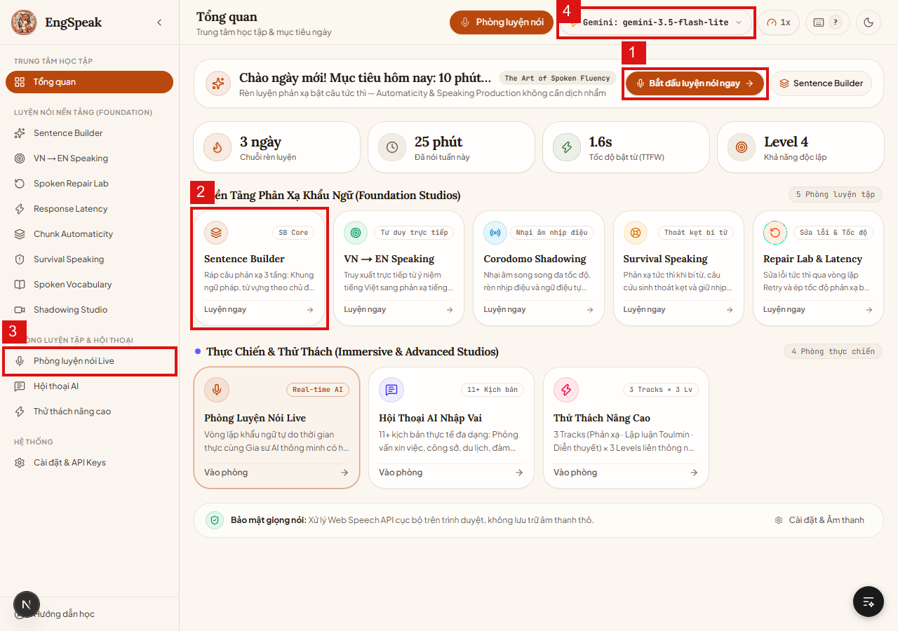

#### C. Ma trận tương tác phần tử (Interactive Elements Matrix)

| ID | Tên phần tử | Loại control | Thao tác người dùng | Phản hồi hệ thống & Logic nghiệp vụ |
|:---:|---|---|---|---|
| **①** | **Bắt đầu luyện nói ngay** | Nút chính (CTA) | Nhấp chuột | Kích hoạt phiên luyện tập thích ứng của ngày hôm nay (mặc định 10 phút, điều phối tự động từ Foundation đến Live Session). |
| **②** | **Thẻ Sentence Builder (Luyện ngay)** | Card điều hướng | Nhấp chuột | Mở trực tiếp Studio Ráp câu phản xạ 3 tầng (`/sentence-builder`). |
| **③** | **Phòng luyện nói Live** | Menu sidebar | Nhấp chuột | Chuyển hướng sang màn hình đàm thoại trực tiếp với gia sư AI (`/session`). |
| **④** | **Trạng thái Model Badge** | Selector / Dropdown | Xem / Nhấp chuột | Hiển thị model AI đang kích hoạt (VD: `Gemini: gemini-3.5-flash-lite`). Cho phép chọn nhanh model AI mà không cần vào Settings. |

---

### 5.2. Khảo sát năng lực ban đầu (`/baseline`)

#### A. Mục đích nghiệp vụ
Thực hiện đánh giá chẩn đoán đầu vào qua **7 nhiệm vụ động (§7–8)**: đánh giá đa chiều về tốc độ phản xạ (Response Speed), khả năng kiến tạo câu (Sentence Production), độ trôi chảy (Fluency) và vốn từ vựng kích hoạt. Kết quả thiết lập level xuất phát từ 0 đến 10.

#### B. Ảnh chụp giao diện có chú thích
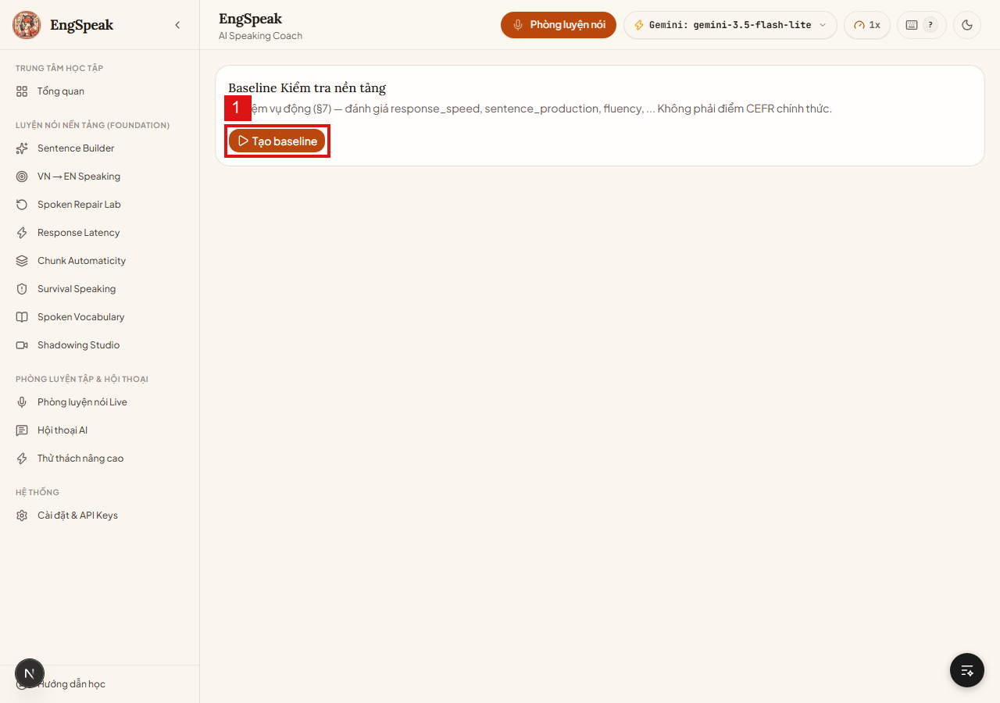

#### C. Ma trận tương tác phần tử

| ID | Tên phần tử | Loại control | Thao tác người dùng | Phản hồi hệ thống & Logic nghiệp vụ |
|:---:|---|---|---|---|
| **①** | **Tạo baseline** | Nút lệnh chính | Nhấp chuột | Kích hoạt máy sinh đề bài kiểm tra. Hệ thống khởi tạo bài thi 7 tasks động, bật micro và chuẩn bị bộ đếm thời gian phản xạ (TTFW timer). |

---

### 5.3. Sentence Builder — Ráp câu 3 tầng (`/sentence-builder`)

#### A. Mục đích nghiệp vụ
Khôi phục phản xạ kiến tạo câu từ cấp độ Khung ngữ pháp (Level A) → Điền từ vựng (Level B) → Hoàn thiện khẩu ngữ tự nhiên (Level C). Giúp người học làm chủ cấu trúc câu phức tạp mà không bị vấp.

#### B. Ảnh chụp giao diện có chú thích
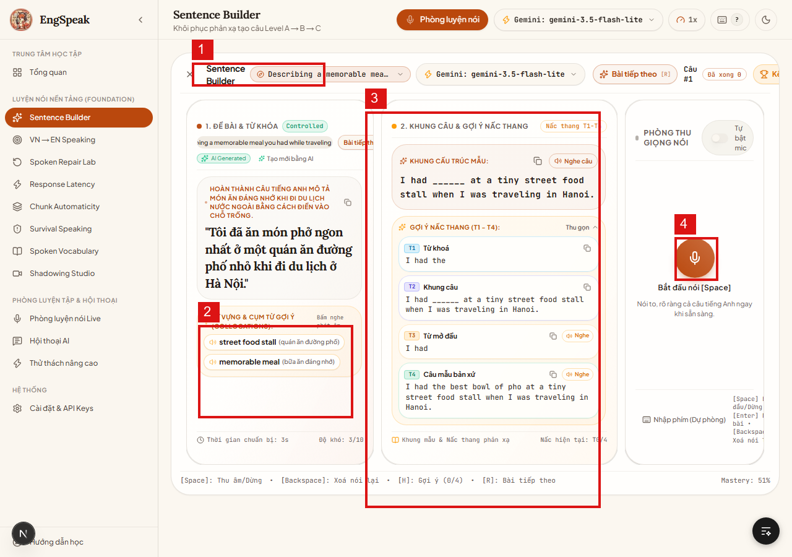

#### C. Ma trận tương tác phần tử

| ID | Tên phần tử | Loại control | Thao tác người dùng | Phản hồi hệ thống & Logic nghiệp vụ |
|:---:|---|---|---|---|
| **①** | **Bộ chọn chủ đề tình huống** | Dropdown select | Nhấp chuột chọn chủ đề | Tải ngân hàng bài tập theo ngữ cảnh (VD: *Describing a memorable meal while traveling*). |
| **②** | **Cụm từ gợi ý (Collocations)** | Danh sách / Audio chip | Nhấp biểu tượng loa | Phát âm mẫu chuẩn bản xứ của các cụm từ đinh (*street food stall*, *memorable meal*) để học viên nhại theo. |
| **③** | **Khung cấu trúc & Nấc thang T1–T4** | Khung hướng dẫn động | Xem nấc thang gợi ý | Cung cấp 4 nấc thang phản xạ: T1 (Từ khóa) → T2 (Khung câu khuyết) → T3 (Từ mở đầu) → T4 (Câu mẫu bản xứ hoàn chỉnh). |
| **④** | **Phòng thu mic [Space]** | Nút micro tròn | Nhấn Space hoặc Click | Bắt đầu thu âm phát âm câu hoàn chỉnh. Nhấn lại để kết thúc, hệ thống tự động chấm điểm ngữ âm và độ chuẩn cấu trúc. |

---

### 5.4. VN → EN Speaking — Phản xạ trực tiếp (`/vn-to-en`)

#### A. Mục đích nghiệp vụ
Luyện phản xạ truy xuất trực tiếp từ ý niệm tiếng Việt sang câu khẩu ngữ tiếng Anh tương đương. Triệt tiêu hoàn toàn thói quen dịch từng từ (word-by-word translation) gây nghẽn tốc độ nói.

#### B. Ảnh chụp giao diện có chú thích
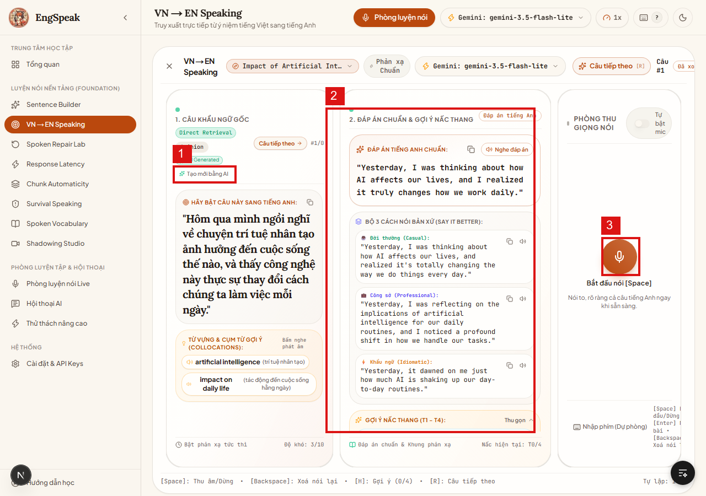

#### C. Ma trận tương tác phần tử

| ID | Tên phần tử | Loại control | Thao tác người dùng | Phản hồi hệ thống & Logic nghiệp vụ |
|:---:|---|---|---|---|
| **①** | **Tạo mới bằng AI** | Nút lệnh AI | Nhấp chuột | AI sinh ngẫu nhiên một tình huống khẩu ngữ đời thực mới bằng tiếng Việt kèm bộ từ khóa kích hoạt. |
| **②** | **Đáp án chuẩn & Bộ 3 cách nói bản xứ** | Card thông tin đối chiếu | Đọc & nghe audio mẫu | Hiển thị 3 phong cách diễn đạt: Đời thường (Casual), Công sở (Professional), Khẩu ngữ (Idiomatic) kèm phân tích ngữ cảnh dùng. |
| **③** | **Phòng thu giọng nói [Space]** | Nút micro tròn | Bấm Space / Nhấp mic | Ghi âm câu nói phản xạ của người học ngay khi đọc xong đề bài tiếng Việt. |

---

### 5.5. Spoken Repair Lab — Sửa lỗi khẩu ngữ tức thì (`/retry-lab`)

#### A. Mục đích nghiệp vụ
Triển khai chu trình học tập **Correct → Say Again**: Phát hiện lỗi sai về tính tự nhiên (Naturalness) hoặc collocation sai lệch, hướng dẫn nguyên tắc bản xứ và yêu cầu người học nói lại ngay câu đúng để tạo rãnh ghi nhớ thần kinh.

#### B. Ảnh chụp giao diện có chú thích
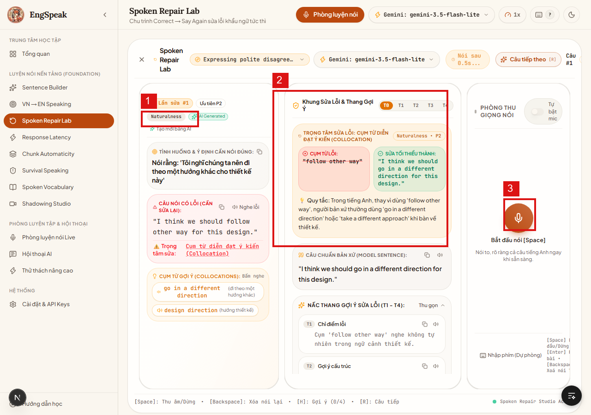

#### C. Ma trận tương tác phần tử

| ID | Tên phần tử | Loại control | Thao tác người dùng | Phản hồi hệ thống & Logic nghiệp vụ |
|:---:|---|---|---|---|
| **①** | **Tạo mới bằng AI** | Nút lệnh | Nhấp chuột | Tải tình huống lỗi sai điển hình của người Việt (VD: dùng *follow other way* thay vì *go in a different direction*). |
| **②** | **Khung sửa lỗi & Trọng tâm sửa** | Bảng phân tích đối chiếu | Xem phân tích | Chỉ rõ cụm từ lỗi, đề xuất phương án sửa tối thiểu (Minimum Viable Correction) và giải thích quy tắc ngữ dụng của người bản xứ. |
| **③** | **Phòng thu giọng nói [Space]** | Nút micro | Bấm Space / Thu âm | Người học phát âm lại câu đã được sửa chuẩn để hệ thống kiểm tra và nâng điểm độ thành thạo (Mastery). |

---

### 5.6. Survival Speaking — Phản xạ sinh tồn & Né từ cấm (`/survival`)

#### A. Mục đích nghiệp vụ
Huấn luyện kỹ thuật **Circumlocution Gym**: Rèn luyện phản xạ sinh tồn khi quên từ vựng đích. Người học bắt buộc phải mô tả đồ vật/khái niệm bằng tiếng Anh mà **tuyệt đối không được sử dụng từ cấm** (cấm dùng từ mục tiêu).

#### B. Ảnh chụp giao diện có chú thích
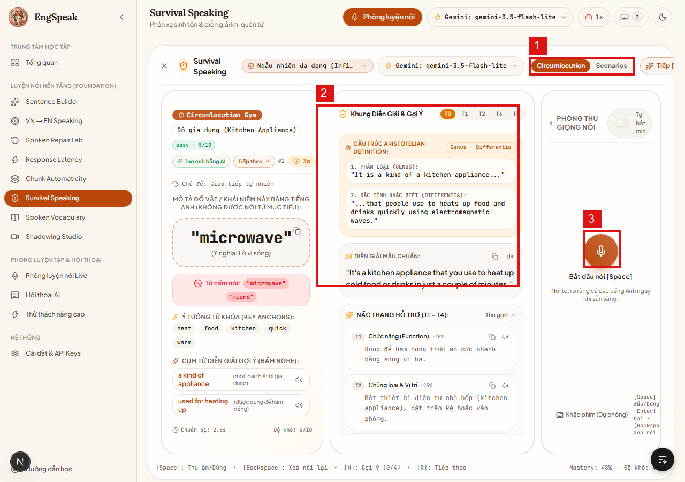

#### C. Ma trận tương tác phần tử

| ID | Tên phần tử | Loại control | Thao tác người dùng | Phản hồi hệ thống & Logic nghiệp vụ |
|:---:|---|---|---|---|
| **①** | **Chuyển chế độ Circumlocution / Scenarios** | Toggle button | Nhấp chuột chuyển chế độ | Chọn giữa bài tập né từ đơn lẻ (Circumlocution) hoặc tình huống giao tiếp sinh tồn khẩn cấp (Scenarios). |
| **②** | **Cấu trúc Aristotelian Definition** | Khung gợi ý logic | Xem hướng dẫn | Hướng dẫn định nghĩa vật thể theo chuẩn: `1. Phân loại (Genus) + 2. Đặc tính khác biệt (Differentia)`. |
| **③** | **Phòng thu giọng nói [Space]** | Nút micro | Bấm thu âm | Người học mô tả khái niệm (VD: lò vi sóng - *microwave*) trong vòng 30 giây mà không phạm luật từ cấm. |

---

### 5.7. Corodomo Shadowing Studio (`/shadowing`)

#### A. Mục đích nghiệp vụ
Huấn luyện nhại âm song song (Shadowing) theo video YouTube thực tế: phân tích chỉ số CEFR, luyện ngắt nhịp thở, nối âm (linking sounds) và ngữ điệu tự nhiên.

#### B. Ảnh chụp giao diện có chú thích
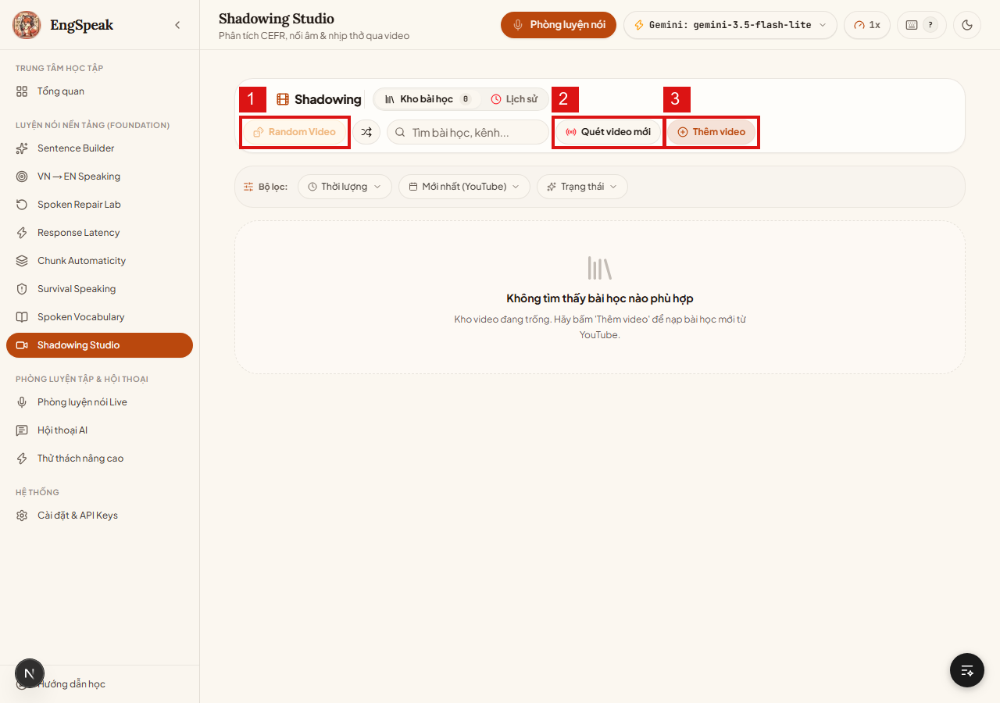

#### C. Ma trận tương tác phần tử

| ID | Tên phần tử | Loại control | Thao tác người dùng | Phản hồi hệ thống & Logic nghiệp vụ |
|:---:|---|---|---|---|
| **①** | **Random Video** | Nút hành động | Nhấp chuột | Chọn ngẫu nhiên một video bài học từ kho lưu trữ để bắt đầu bài luyện Shadowing. |
| **②** | **Quét video mới** | Nút đồng bộ | Nhấp chuột | Quét các bài học mới cập nhật từ các kênh YouTube luyện nói chuẩn bản ngữ. |
| **③** | **Thêm video** | Nút thêm dữ liệu | Nhấp chuột | Nhập URL YouTube bất kỳ để AI tự động bóc tách transcript, phân đoạn câu và tạo bài tập nhại âm. |

---

### 5.8. Phòng luyện nói Live (`/session`)

#### A. Mục đích nghiệp vụ
Vòng lặp khẩu ngữ tự do thời gian thực với gia sư AI thông minh: **AI nói → Người học nói → Ghi âm → STT → Transcript → AI phản hồi → TTS phát âm**. Hỗ trợ đàm thoại đa chủ đề.

#### B. Ảnh chụp giao diện có chú thích
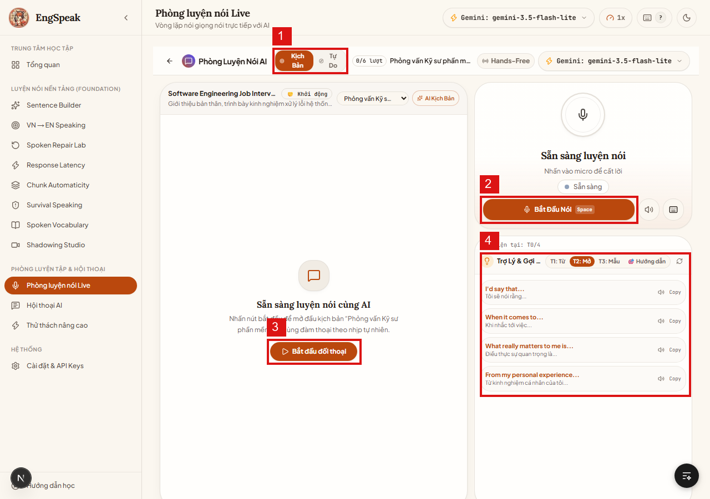

#### C. Ma trận tương tác phần tử

| ID | Tên phần tử | Loại control | Thao tác người dùng | Phản hồi hệ thống & Logic nghiệp vụ |
|:---:|---|---|---|---|
| **①** | **Kịch Bản / Tự Do** | Toggle switch | Nhấp chuyển chế độ | Chuyển đổi giữa chế độ đàm thoại theo kịch bản có định hướng hoặc trò chuyện mở hoàn toàn tự do. |
| **②** | **Bắt Đầu Nói [Space]** | Nút chính | Nhấn Space / Click | Kích hoạt micro ghi âm lượt nói của người học. Đèn trạng thái chuyển sang màu đỏ đang ghi. |
| **③** | **Bắt đầu đối thoại** | Nút kích hoạt | Nhấp chuột | Gửi transcript lượt thoại sang AI để sinh câu đáp tiếp theo kèm ngữ điệu phù hợp. |
| **④** | **Trợ Lý & Gợi Ý (Nấc T1–T3)** | Bảng trợ giúp phản xạ | Xem / Nghe câu mẫu | Cung cấp câu mở đầu theo 3 nấc độ khó (T1: Từ vựng, T2: Câu mở, T3: Câu hoàn chỉnh) khi người học bị bí ý tưởng. |

---

### 5.9. Phòng Drill phản xạ đơn câu (`/practice`)

#### A. Mục đích nghiệp vụ
Phòng tập gym khẩu ngữ cường độ cao: Đưa ra một câu hỏi kích thích duy nhất, yêu cầu người học phát âm câu trả lời trong giới hạn thời gian, sau đó AI chấm điểm chi tiết trên thang 100 điểm.

#### B. Ảnh chụp giao diện có chú thích
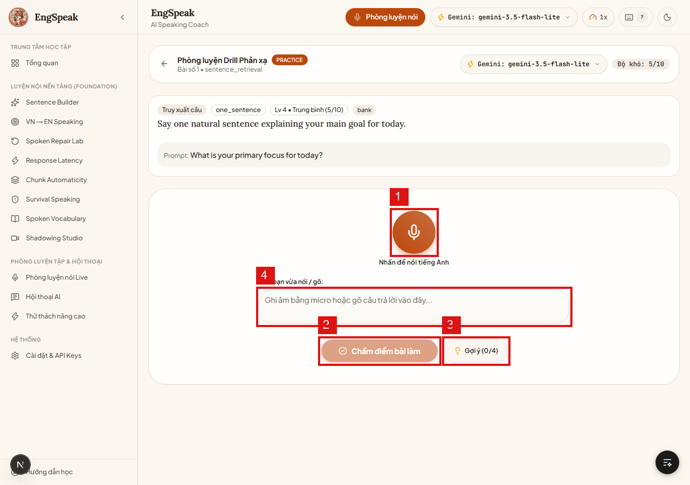

#### C. Ma trận tương tác phần tử

| ID | Tên phần tử | Loại control | Thao tác người dùng | Phản hồi hệ thống & Logic nghiệp vụ |
|:---:|---|---|---|---|
| **①** | **Nút micro trung tâm** | Icon button lớn | Nhấp chuột | Thu âm câu trả lời của người học cho đề bài hiển thị trên màn hình. |
| **②** | **Chấm điểm bài làm** | Nút xử lý | Nhấp chuột | Chuyển dữ liệu audio/text về AI để chấm Practice Score (0–100) và trả về nhận xét 5 tiêu chí. |
| **③** | **Gợi ý (0/4)** | Nút hỗ trợ | Nhấp chuột | Mở nấc gợi ý tiếp theo (tối đa 4 nấc: từ khóa → cấu trúc → mẫu câu). |
| **④** | **Ô nhập văn bản dự phòng** | Textarea input | Gõ bàn phím | Cho phép gõ câu trả lời bằng phím trong trường hợp môi trường ồn hoặc micro bị lỗi phần cứng. |

---

### 5.10. Thế giới giao tiếp & Hội thoại AI nhập vai (`/conversation`)

#### A. Mục đích nghiệp vụ
Môi trường mô phỏng 14+ kịch bản thực tế: Công sở, Đàm phán lương, Phỏng vấn STAR, Check-in sân bay, Tranh luận hội đồng... Có khả năng mô phỏng tính cách nhân vật (Persona), cảm xúc, và các sự kiện bất ngờ (Unexpected Events).

#### B. Ảnh chụp giao diện có chú thích
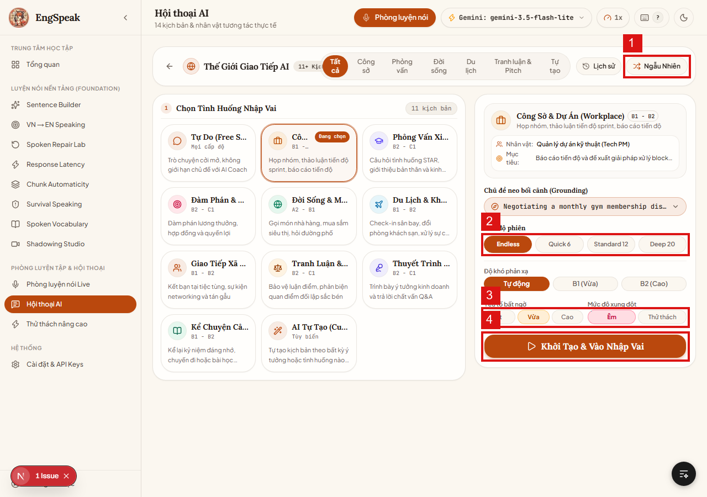

#### C. Ma trận tương tác phần tử

| ID | Tên phần tử | Loại control | Thao tác người dùng | Phản hồi hệ thống & Logic nghiệp vụ |
|:---:|---|---|---|---|
| **①** | **Ngẫu Nhiên** | Nút bốc thăm | Nhấp chuột | AI tự động chọn ngẫu nhiên một tình huống kịch bản bất ngờ để rèn luyện tính linh hoạt. |
| **②** | **Chế độ phiên (Endless / Quick / Standard)** | Nhóm nút chọn | Chọn thời lượng | Giới hạn số lượt trao đổi: Endless (Vô tận), Quick 6 (6 lượt), Standard 12 (12 lượt), Deep 20 (20 lượt). |
| **③** | **Yếu tố bất ngờ & Mức độ xung đột** | Bộ điều khiển | Chọn mức độ | Thiết lập mức độ kịch tính: Bất ngờ (Ít/Vừa/Cao) và Xung đột (Êm dịu/Thử thách đối kháng). |
| **④** | **Khởi Tạo & Vào Nhập Vai** | Nút CTA lớn | Nhấp chuột | Tạo lập World State hoàn chỉnh, khởi tạo nhân vật AI và mở phòng nhập vai. |

---

### 5.11. Thử thách nâng cao — Áp lực & Lập luận Toulmin (`/advanced`)

#### A. Mục đích nghiệp vụ
Huấn luyện cho học viên trình độ B2–C1 với 3 đường bay thử thách:
1. **Phản xạ dưới áp lực (Blitz 3–6s):** Trả lời ngay lập tức, chuyển đổi chủ đề đột ngột.
2. **Lập luận & Đối kháng:** Áp dụng mô hình Toulmin (Claim → Data → Warrant) để bảo vệ quan điểm.
3. **Diễn thuyết mạch dài:** Nói liên tục 1–3 phút có cấu trúc mở - thân - kết.

#### B. Ảnh chụp giao diện có chú thích
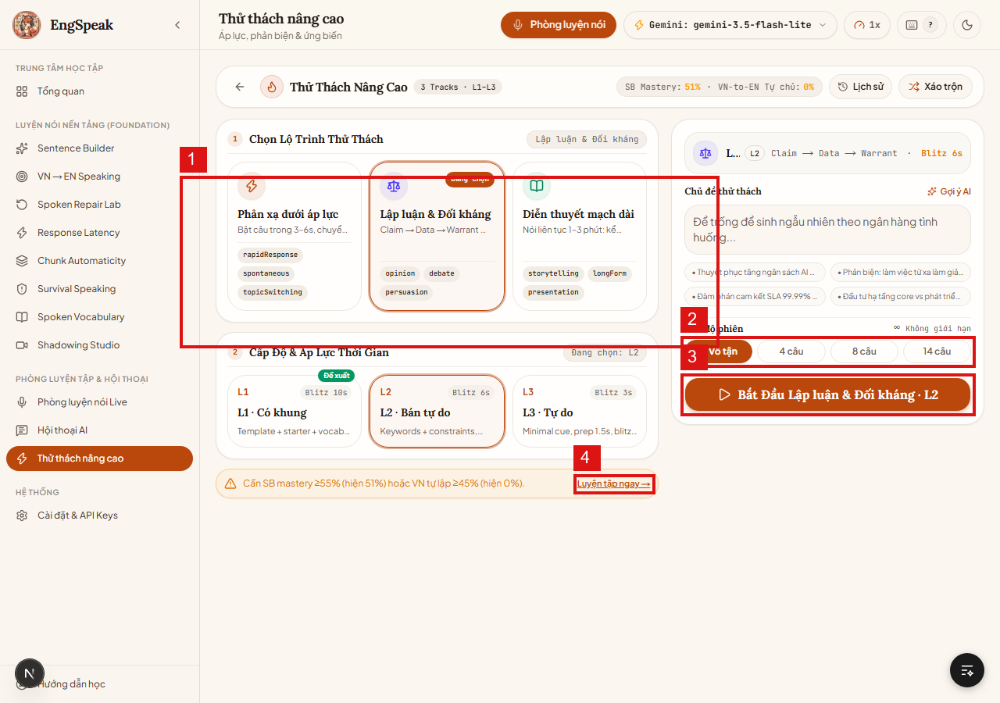

#### C. Ma trận tương tác phần tử

| ID | Tên phần tử | Loại control | Thao tác người dùng | Phản hồi hệ thống & Logic nghiệp vụ |
|:---:|---|---|---|---|
| **①** | **Bộ 3 Lộ trình thử thách** | Nhóm thẻ lựa chọn | Nhấp chọn lộ trình | Chọn giữa 3 đường bay: Phản xạ áp lực, Lập luận đối kháng, hoặc Diễn thuyết mạch dài. |
| **②** | **Cơ số câu hỏi (Vô tận / 4 / 8 / 14 câu)** | Button group | Nhấp chọn | Thiết lập độ dài của phiên thử thách. |
| **③** | **Bắt Đầu Lập luận & Đối kháng** | Nút khởi động | Nhấp chuột | Kích hoạt phiên thử thách với mức độ áp lực thời gian đã cấu hình. |
| **④** | **Cảnh báo điều kiện & Nút mở khóa** | Link điều hướng | Nhấp chuột | Hiển thị điều kiện tiên quyết (VD: cần Sentence Builder mastery ≥ 55%). Bấm để chuyển về phòng luyện nền tảng nếu chưa đủ chuẩn. |

---

### 5.12. Cài đặt hệ thống, Micro & Quản trị API Keys (`/settings`)

#### A. Mục đích nghiệp vụ
Trung tâm kiểm soát phần cứng và kết nối nhà cung cấp AI: Cấu hình khóa API độc lập cho Google Gemini và Groq, kiểm tra mic/loa, chuyển đổi model linh hoạt, và bật debug logs.

#### B. Ảnh chụp giao diện có chú thích
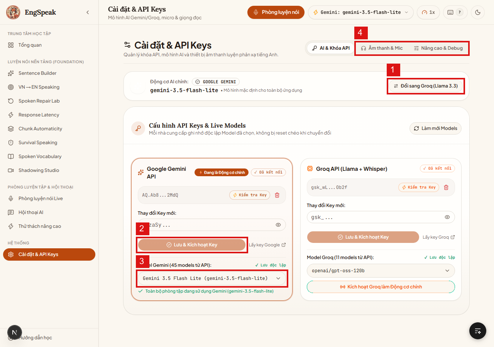

#### C. Ma trận tương tác phần tử

| ID | Tên phần tử | Loại control | Thao tác người dùng | Phản hồi hệ thống & Logic nghiệp vụ |
|:---:|---|---|---|---|
| **①** | **Đổi sang Groq (Llama 3.3)** | Nút chuyển nhanh | Nhấp chuột | Đổi động cơ AI chính sang Groq khi Google Gemini gặp sự cố mạng hoặc hết hạn ngạch. |
| **②** | **Lưu & Kích hoạt Key** | Form nhập & Nút lưu | Dán key & Nhấp lưu | Lưu trữ an toàn khóa API vào cấu hình cục bộ (Local Storage/SQLite). Có nút kiểm tra tính hợp lệ của key ngay lập tức. |
| **③** | **Dropdown chọn Model chuyên biệt** | Dropdown list | Nhấp chọn model | Danh sách 45+ models từ API (Gemini 2.5 Flash, 3.5 Flash Lite, Llama 3.3 70B...). |
| **④** | **Tab Âm thanh & Mic / Nâng cao** | Tab bar | Nhấp chọn tab | Cấu hình độ nhạy micro, chọn thiết bị đầu vào âm thanh, và bật telemetry logs. |

---

## 6. MA TRẬN XỬ LÝ LỖI & TÌNH HUỐNG NGOẠI LỆ (EXCEPTION HANDLING)

| Mã lỗi / Hiện tượng | Nguyên nhân kỹ thuật | Hướng xử lý của Hệ thống | Hướng dẫn thao tác cho Người dùng |
|---|---|---|---|
| **ERR_MIC_DENIED** | Trình duyệt chưa được cấp quyền truy cập Microphone. | Chuyển FSM sang trạng thái `error`, vô hiệu hóa nút thu âm, hiển thị banner cảnh báo đỏ. | Nhấp vào biểu tượng Ổ khóa / Cài đặt trang web trên thanh địa chỉ của trình duyệt → Bật quyền **Microphone** sang **Allow** → Tải lại trang (F5). |
| **ERR_AI_RATE_LIMIT (HTTP 429)** | Khóa API Gemini hoặc Groq vượt quá giới hạn tần suất yêu cầu (Quota Exceeded). | Hiển thị thông báo chi tiết lỗi provider, không tự động fallback ngầm để tránh lỗi dây chuyền (§36). | Truy cập màn hình **Cài đặt & API Keys (`/settings`)** → Nhấn nút **Đổi sang Groq** hoặc dán khóa API dự phòng khác. |
| **ERR_STT_SILENT** | Người học bấm mic nhưng không phát âm, hoặc môi trường quá ồn khiến STT không nhận diện được từ. | Trạng thái STT trả về chuỗi rỗng sau 5 giây im lặng; hệ thống phát thông báo *"Chưa nghe rõ âm thanh"*. | Nói to, rõ ràng hơn, đưa micro lại gần miệng, hoặc chuyển sang chế độ **Nhập phím (Dự phòng)**. |
| **ERR_AUDIO_PLAY_BLOCKED** | Chính sách Autoplay của trình duyệt chặn AI tự động phát âm thanh khi người dùng chưa tương tác. | Hiển thị nút "Bấm để nghe" thay vì tự phát cưỡng bức. | Nhấp một thao tác bất kỳ trên màn hình để cấp quyền phát âm thanh tự động cho trang web. |
| **ERR_DB_LOCKED** | SQLite cục bộ (`data/app.db`) đang bị khóa bởi tiến trình khác. | Tiến trình kích hoạt cơ chế retry tự động với exponential backoff trong 3000ms. | Khởi động lại máy chủ ứng dụng: tắt terminal và chạy lại `pnpm dev`. |

---

## 7. HỆ THỐNG PHÍM TẮT ĐIỀU KHIỂN NHANH (KEYBOARD SHORTCUTS)

Hệ thống hỗ trợ thao tác hoàn toàn không cần dùng chuột để duy trì trạng thái tập trung cao độ (Flow State):

| Phím tắt | Phạm vi áp dụng | Hành động nghiệp vụ |
|:---:|---|---|
| **`Space`** (Phím cách) | Tất cả các phòng luyện | **Bật / Dừng ghi âm micro** (Nhấn lần 1 để bắt đầu nói, nhấn lần 2 để hoàn tất). |
| **`Enter`** | Phòng Drill & Sentence Builder | **Nộp bài / Chấm điểm bài làm tức thì**. |
| **`Backspace`** | Màn hình luyện tập | **Xóa kết quả nói gần nhất để nói lại từ đầu**. |
| **`H`** | Sentence Builder, Survival, Drill | **Mở nấc gợi ý tiếp theo** (Hint escalation T0 → T4). |
| **`R`** | Tất cả các Studio nền tảng | **Chuyển sang bài tập tiếp theo** (Next exercise). |
| **`Esc`** | Các phòng luyện tập | **Thoát khỏi Studio hiện tại** và quay về Dashboard Tổng quan. |

---

> **Kết luận của Chuyên viên Phân tích Nghiệp vụ (BA):**  
> Tài liệu trên cung cấp bức tranh toàn diện từ cơ chế sư phạm, kiến trúc xử lý, quy trình nghiệp vụ đến từng thao tác chi tiết trên giao diện người dùng kèm bằng chứng ảnh chụp trực quan. Toàn bộ tính năng đã được kiểm thử tính sẵn sàng và vận hành ổn định trên môi trường thực tế.
